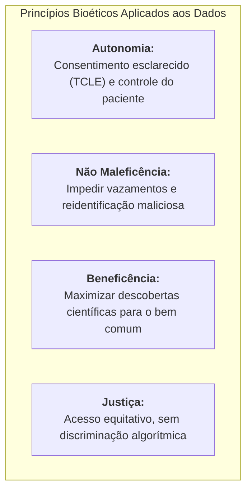
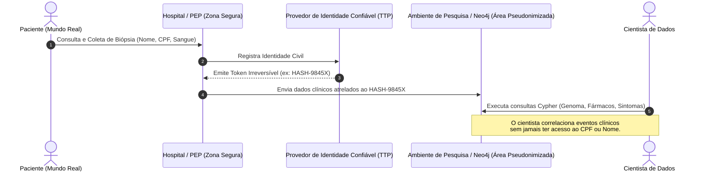
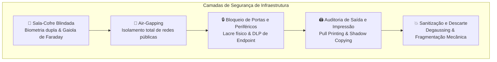
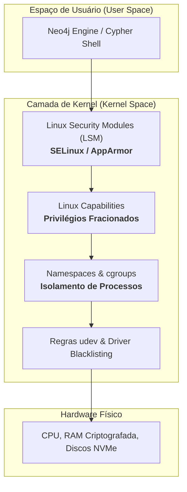
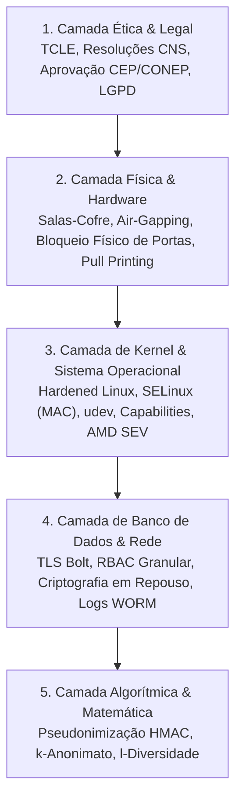

## 👨‍🏫 Metadados e Informações Acadêmicas
- **Instituição:** Faculdade de Tecnologia de Ferraz de Vasconcelos (FATEC-FV)
- **Curso:** Análise e Desenvolvimento de Sistemas (ADS)
- **Disciplina:** Tópicos em Banco de Dados e Big Data
- **Professor Orientador:** Prof. Francisco Abreu
- **Pesquisador / Desenvolvedor:** Josias Sobrinho
- **Documento:** Tratado Técnico de Bioética, Governança e Blindagem de Infraestrutura em Pesquisas Médicas

# 🛡️ Bioética, Governança e Blindagem de Dados em Pesquisas Médicas

> [!NOTE]
> Este documento aprofunda os aspectos éticos, jurídicos e de segurança cibernética (infraestrutura física e sistemas operacionais) exigidos para armazenar e cruzar prontuários e genomas de pacientes em larga escala.
> - Para a aplicação clínica e científica com grafos, consulte [neo4j-pesquisas-medicas.md](file:///var/www/html/topicos-bd/neo4j/neo4j-pesquisas-medicas.md).
> - Para os fundamentos arquiteturais do banco de dados, consulte [neo4j.md](file:///var/www/html/topicos-bd/neo4j/neo4j.md).
> - Para o laboratório prático com contêineres Docker, consulte [README.md](file:///var/www/html/topicos-bd/neo4j/README.md).

---

## 🎯 Introdução: O Dilema Ético na Era do Big Data em Saúde

Na era da medicina orientada a dados, da genômica computacional e dos *Medical Knowledge Graphs*, a ciência vive uma encruzilhada ética fundamental:
- Por um lado, o **cruzamento massivo de dados clínicos** acelera a descoberta de vacinas, diagnósticos precoces de câncer e terapias personalizadas que salvam vidas.
- Por outro lado, a saúde e o genoma representam a categoria mais íntima e inviolável de dados pessoais (**dados pessoais sensíveis**). O vazamento ou uso descontrolado dessas informações pode resultar em estigmatização, discriminação genética por seguradoras ou empregadores, e violação irreparável da dignidade humana.

A **Bioética Informacional** estabelece que a tecnologia de armazenamento e processamento de dados (como bancos de dados NoSQL e sistemas operacionais) deve implementar salvaguardas técnicas intransponíveis para garantir os quatro princípios bioéticos clássicos de Beauchamp e Childress:



---

## 🧬 1. O Paradigma da Pseudonimização e Anonimização Reversível

A **pseudonimização** é a técnica central recomendada pelo Regulamento Geral de Proteção de Dados (GDPR na Europa) e pela Lei Geral de Proteção de Dados (LGPD - Lei nº 13.709/2018 no Brasil). Ela consiste no tratamento de dados de modo que eles não possam mais ser atribuídos a um titular específico sem o uso de informações suplementares mantidas separadamente.



### 1.1. A Figura do Provedor de Identidade Confiável (*Trusted Third Party - TTP*)
Para viabilizar a segregação de dados, adota-se a arquitetura de **Tercerização Confiável de Identidade**:
- **A Chave Mestre:** O hospital mantém um cofre de dados criptografado em repositório isolado contendo o vínculo unívoco entre os dados civis (nome, CPF, RG) e um identificador sintético gerado criptograficamente (ex.: `UUIDv4` ou `SHA-256` salgado).
- **A Barreira Técnica:** Os cientistas de dados, analistas de bioinformática e modelos de inteligência artificial jamais recebem credenciais de acesso ao cofre de identidades. Todo o grafo no Neo4j é estruturado utilizando apenas o identificador opaco:
  ```cypher
  CREATE (p:Paciente {id_pseudonimo: "8f7b2c14-5d89-4e92-bc12-9e8a71234567"})
  ```

### 1.2. Como os Dados Multicêntricos são Cruzados?
Imagine uma pesquisa sobre câncer de mama conduzida por três instituições distintas:
1. O **Hospital A** fornece o histórico de quimioterapias e sintomas.
2. O **Laboratório B** realiza o sequenciamento genômico completo (DNA).
3. O **Centro de Diagnóstico C** fornece imagens de ressonância magnética.

Mediante uma função criptográfica determinística com chave secreta compartilhada (*Hash-based Message Authentication Code - HMAC*), os três centros convertem o identificador civil do paciente no mesmo pseudônimo alfanumérico. No Neo4j, os três fluxos de dados convergem para o mesmo nó central sem que nenhuma instituição exponha a identidade real do cidadão às demais.

### 1.3. Salvaguardas Matemáticas contra Reidentificação
A simples substituição do nome por um código não é infalível. Se uma base de pesquisa revelar que *"um homem de 62 anos, residente em um bairro específico de Ferraz de Vasconcelos, foi internado em 15 de janeiro com uma doença raríssima"*, qualquer pessoa com acesso a notícias ou redes sociais pode **reidentificar o indivíduo**.

Para mitigar o risco de triangulação, adotam-se técnicas matemáticas avançadas:

| Técnica | Conceito Operacional | Exemplo Prático no Banco de Dados |
| :--- | :--- | :--- |
| **$k$-Anonimato** | Garante que cada indivíduo seja indistinguível de pelo menos outros $k - 1$ indivíduos na mesma base. | Generalização de idades em faixas decenais (`idade: "50-60"`) e locais por macrorregiões (`regiao: "Alto Tietê"`). |
| **$l$-Diversidade** | Estende o $k$-anonimato exigindo que, dentro de cada grupo homogêneo, haja diversidade suficiente de diagnósticos sensíveis. | Evita que todos os 5 pacientes de um mesmo cluster possuam a mesma patologia estigmatizante (ex.: HIV). |
| **Hashes Salgados Dinâmicos** | Aplicação de números pseudoaleatórios secretos (*Salt*) antes de aplicar a função hash. | Impede ataques de dicionário e comparação maliciosa de IDs entre pesquisas distintas. |

### 1.4. O Marco Regulatório: CEP/CONEP e LGPD
No Brasil, toda investigação biomédica obedece às **Resoluções CNS 466/2012 e 510/2016** do Conselho Nacional de Saúde:
- **CEP (Comitê de Ética em Pesquisa):** Colegiado interdisciplinar independente que avalia a proporcionalidade, os riscos e as salvaguardas dos protocolos de pesquisa.
- **CONEP (Comissão Nacional de Ética em Pesquisa):** Instância federal do Ministério da Saúde que aprova pesquisas em áreas estratégicas ou de alta complexidade (genética humana, novos fármacos).
- **TCLE (Termo de Consentimento Livre e Esclarecido):** Instrumento formal pelo qual o paciente autoriza o tratamento codificado de seus dados após ser informado dos riscos, benefícios e finalidades científicas.

---

## 🔑 2. Governança, Controle de Acesso e Auditoria Imutável

Mesmo com bases devidamente pseudonimizadas, uma falha de governança interna ou um operador desonesto pode comprometer todo o sistema de saúde. A governança baseia-se em **controles lógicos e rastreabilidade estrita**:

```mermaid
graph LR
    subgraph "Camadas de Acesso Qualificado"
        U["Pesquisador Clínico"] -->|Autenticação Forte 2FA / ICP-Brasil| GW["API Gateway / Proxy"]
        GW -->|Verificação de Privilégio Mínimo (RBAC)| DB[("Neo4j Database")]
        DB -->|Registro Assíncrono| WORM["Cofre de Logs WORM / SIEM<br/>(Imutável & Criptografado)"]
    end
```

### 2.1. Princípio do Privilégio Mínimo e Segregação de Funções (*Need-to-Know*)
O acesso aos dados é concedido estritamente com base na qualificação profissional e na hipótese científica aprovada pelo comitê de ética:
- **Médico Investigador:** Acesso a biomarcadores, exames laboratoriais e desfechos clínicos. Sem acesso a chaves criptográficas ou infraestrutura de rede.
- **Engenheiro de Dados / DBA:** Acesso a métricas operacionais do Neo4j, desempenho de consultas e particionamento de índices. **Sem autorização técnica para decodificar prontuários ou visualizar dados de saúde desmascarados**.

### 2.2. Autenticação Forte e Não Repúdio
- Exigência de múltiplos fatores de autenticação (MFA/2FA) com chaves físicas FIDO2/WebAuthn ou certificados digitais padrão **ICP-Brasil** (e-CPF institucional).
- Cada transação no banco de dados fica atrelada de forma não repudiável ao registro profissional do operador (CRM para médicos, CRF para farmacêuticos, CRBio para biólogos).

### 2.3. A "Caixa-Preta" Digital: Logs Imutáveis (*WORM*)
Os registros de auditoria em pesquisas clínicas operam sob o padrão **WORM (Write Once, Read Many)**:
- Todo comando `MATCH`, `CREATE` ou `SET` disparado no Neo4j gera uma entrada no sistema central de auditoria (*SIEM - Security Information and Event Management*).
- O log armazena:
  - Assinatura digital do usuário;
  - Carimbo do tempo (*timestamp*) de relógio atômico sincronizado por NTP autenticado;
  - A consulta Cypher literal enviada;
  - O endereço IP de origem e a impressão digital da máquina (*machine fingerprint*).
- Os volumes de log são gravados em mídias criptograficamente seladas ou encadeadas por blocos criptográficos com hashes irreversíveis, impedindo que administradores mal-intencionados apaguem rastros de consultas indevidas.

---

## 🏢 3. Segurança Física e Isolamento de Infraestrutura (Hardware Hardening)

A melhor criptografia de software é inútil se um agente puder acessar fisicamente a máquina servidora, subtrair discos ou conectar dispositivos maliciosos.



### 3.1. Isolamento Físico Estrito (*Air-Gapping*)
Para dados genômicos ultra-estratégicos (como sequenciamento populacional ou pesquisas de biodefesa), adota-se a arquitetura de **Air-Gap**:
- O cluster que processa os dados de saúde reside em uma rede local proprietária **sem qualquer conexão física com a internet pública**.
- Placas de interface de rede sem fio (Wi-Fi), módulos Bluetooth e modems celulares são fisicamente removidos das placas-mãe dos servidores em nível de fabricação.
- A ingestão de novos dados laboratoriais ocorre exclusivamente por meio de estações dedicadas de quarentena (*Data Diodes* e sistemas de transferência unidirecional por fibra óptica).

### 3.2. Bloqueio Mecânico e Lógico de Periféricos (Anti-Exfiltração)
- **Barreira Física:** Todas as portas USB, conexões Thunderbolt e saídas de vídeo desnecessárias recebem lacres de resina epóxi invioláveis ou travas físicas de bloqueio de porta com chave mestra.
- **Prevenção de Perda de Dados (*Data Loss Prevention - DLP*):** Sistemas de proteção de endpoint monitoram barramentos de entrada/saída em tempo real. Se um dispositivo USB não autorizado for detectado, o sistema congela a interface de barramento e emite um alerta prioritário para a equipe de segurança física.

### 3.3. Auditoria de Impressão e a Falha do Suporte Físico
A impressora é historicamente o vetor mais negligenciado de exfiltração de dados confidenciais:
- **Impressão Segura (*Pull Printing*):** O trabalho de impressão é retido em um spooler criptografado e só é liberado fisicamente quando o médico autentica seu crachá com biometria diretamente no leitor da impressora, eliminando relatórios esquecidos na bandeja de saída.
- **Cópia de Sombra (*Shadow Copying*):** O servidor de segurança captura automaticamente uma réplica idêntica em formato digital pesquisável de cada folha impressa na organização, correlacionando o documento ao pesquisador solicitante.
- **Micro-Pontos Amarelos (Código de Rastreamento de Máquina):** Impressoras a laser emitem padrões microscópicos imperceptíveis a olho nu em cada folha, codificando o número de série da máquina e a hora da impressão, o que permite perícia forense caso um relatório físico vaze.

### 3.4. Ciclo de Vida e Descarte Seguro de Mídias
O armazenamento de prontuários em discos magnéticos (HDDs) e memórias de estado sólido (SSDs) encerra-se com protocolos rigorosos de sanitização (padrão **NIST SP 800-88 Rev. 1**):
- **Desmagnetização (*Degaussing*):** Submissão de HDs a pulsos magnéticos de alta densidade (acima de 2 Tesla), destruindo completamente a estrutura das partículas magnéticas de orientação de bits.
- **Destruição Mecânica (*Shredding*):** Trituração industrial de placas controladoras e chips de memória flash em fragmentos de tamanho inferior a 2 milímetros, inviabilizando qualquer reconstituição laboratorial por microscopia eletrônica de varredura.

---

## 🐧 4. Endurecimento do Sistema Operacional: O Kernel Linux Blindado

Em servidores de pesquisa biomédica, o gerenciamento de segurança ultrapassa as permissões tradicionais do modelo UNIX (`chmod`, `chown`, permissões `rwx`). Adota-se a metodologia de **Hardening do Kernel Linux**:



### 4.1. Controle de Acesso Mandatório (MAC) com SELinux
Enquanto o modelo padrão de Linux utiliza Controle de Acesso Discricionário (DAC - onde o proprietário do arquivo decide quem pode lê-lo), servidores biomédicos operam sob **Controle de Acesso Mandatório (MAC)**:
- O administrador central define políticas globais imutáveis que nem mesmo o usuário `root` pode burlar.
- Cada processo do Neo4j roda confinado sob um contexto de segurança específico (ex.: `system_u:system_r:neo4j_t:s0`).
- Mesmo que uma vulnerabilidade no software permita que um invasor obtenha uma casca de comando (*shell*) com privilégios de superusuário, o SELinux bloqueia instantaneamente qualquer leitura fora do diretório de dados expressamente permitido:

```bash
# Exemplo de verificação do contexto de segurança do repositório de dados
ls -dZ /data/databases/neo4j
# Saída esperada: system_u:object_r:neo4j_data_t:s0
```

### 4.2. Bloqueio de Periféricos via Kernel (`udev` e `modprobe`)
Para garantir imunidade contra ataques como *BadUSB*, o Kernel Linux é configurado para desativar módulos desnecessários durante a inicialização:

```bash
# /etc/modprobe.d/blacklist-medical-research.conf
# Bloqueio de drivers de armazenamento externo e redes sem fio
blacklist usb_storage
blacklist uas
blacklist bluetooth
blacklist btbcm
blacklist wifi
blacklist mac80211
```

Regras restritivas no subsistema `udev` forçam o desligamento lógico imediato de qualquer dispositivo USB não catalogado:

```udev
# /etc/udev/rules.d/99-block-usb-storage.rules
# Se o subsistema for de armazenamento em bloco USB, desative a interface
ACTION=="add", SUBSYSTEM=="usb", ATTR{bInterfaceClass}=="08", RUN+="/bin/sh -c 'echo 0 > /sys$DEVPATH/authorized'"
```

### 4.3. Fracionamento de Privilégios com *Linux Capabilities*
Serviços modernos de banco de dados não necessitam do poder irrestrito do usuário `root`. O Linux divide os privilégios do superusuário em unidades atômicas (*Capabilities*):
- O processo do banco retém apenas `CAP_NET_BIND_SERVICE` (para abrir portas de rede como 7474 e 7687) e `CAP_SYS_RESOURCE`.
- Todas as capacidades perigosas como `CAP_SYS_ADMIN` (administração geral), `CAP_CHOWN` (alterar donos de arquivos) e `CAP_SYS_RAWIO` (leitura direta de memória/hardware) são definitivamente despojadas no momento da inicialização:

```bash
# Inspecionar as capacidades de um processo em execução
getpcaps $(pgrep neo4j)
```

### 4.4. Isolamento de Memória RAM e Tecnologias de Enclave Seguro
Para proteger dados médicos em processamento volátil contra ataques de leitura direta de memória física:
- **Desativação de `/dev/mem`:** O kernel é compilado com a opção `CONFIG_STRICT_DEVMEM=y`, impedindo qualquer processo de inspecionar áreas de memória atribuídas a outros aplicativos.
- **Confidential Computing (AMD SEV / Intel SGX):** Uso de enclaves criptografados em hardware. A CPU criptografa a memória RAM com chaves geradas em tempo de execução que residem no próprio chip. Mesmo que um atacante conecte analisadores lógicos de sinais físicos diretamente na placa-mãe, os dados lidos dos barramentos de memória serão ilegíveis.

---

## 💻 5. Implementação de Salvaguardas Éticas no Neo4j

Como os conceitos de bioética e controle de acesso se traduzem em comandos práticos dentro do ecossistema Neo4j?

### 5.1. Proteção de Dados com Hashes Criptográficos e Funções APOC
Ao ingerir dados de pacientes no grafo, funções criptográficas determinísticas garantem que nenhum dado nominal seja gravado na camada de persistência:

```cypher
// Criando o nó do paciente aplicando SHA-256 com sal secreto em tempo real
WITH "CPF-123.456.789-00" AS doc_original, "SalSecretoFATEC2026!#" AS sal
MERGE (p:Paciente {
    id_pesquisa: apoc.util.sha256([doc_original + sal]),
    faixa_etaria: "45-55",
    macro_regiao: "Regiao Metropolitana SP",
    consentimento_tcle: true,
    data_consentimento: datetime()
});
```

---

### 5.2. Controle de Acesso Baseado em Papéis no Neo4j (RBAC Granular)
No Neo4j Enterprise, o administrador pode limitar com precisão quais nós e propriedades cada usuário tem permissão de consultar:

```cypher
// 1. Criar o papel para a equipe de cientistas de bioinformática
CREATE ROLE pesquisador_genomica IF NOT EXISTS;

// 2. Permitir leitura completa em Nós de Doenças, Genes e Medicamentos
GRANT MATCH ON GRAPH neo4j NODES Doenca, Gene, Medicamento TO pesquisador_genomica;

// 3. Permitir leitura em Pacientes APENAS para atributos não identificáveis
GRANT MATCH ON GRAPH neo4j NODES Paciente TO pesquisador_genomica;
DENY TRAVERSE ON GRAPH neo4j NODES Paciente(cpf, nome, telefone) TO pesquisador_genomica;

// 4. Bloquear qualquer privilégio de escrita ou exclusão
DENY WRITE ON GRAPH neo4j TO pesquisador_genomica;
```

---

## 🏛️ 6. As Cinco Camadas da Defesa em Profundidade (*Defense-in-Depth*)

A proteção ética dos dados de saúde nunca depende de uma barreira única. Ela exige redundância concêntrica:



1. **Camada Ética e Jurídica:** Protocolo aprovado por comitê de ética e consentimento informado (TCLE).
2. **Camada Física e de Hardware:** Salas blindadas, eliminação de vetores físicos de vazamento e descarte seguro.
3. **Camada de Sistema Operacional:** Kernel Linux imutável com MAC e isolamento de barramento.
4. **Camada de Banco de Dados:** Criptografia de rede (*Bolt over TLS*), autenticação e controle de privilégios em grafos.
5. **Camada Algorítmica:** Hashes matemáticos e salvaguardas de $k$-anonimato que impedem correlações maliciosas.

---

## 📚 7. Conclusão

A ciência médica não precisa escolher entre o progresso terapêutico e a privacidade dos cidadãos. Por meio de uma infraestrutura que alie o poder associativo do **Neo4j**, o rigor do **Kernel Linux Blindado** e as normas bioéticas do **sistema CEP/CONEP e da LGPD**, é possível construir ambientes de pesquisa de classe mundial onde o cruzamento de dados salva vidas sem jamais violar a confiança e a intimidade dos pacientes.

---

## 🔗 Referências e Recursos Relacionados
- Laboratório Prático de Neo4j com Docker: [README.md](file:///var/www/html/topicos-bd/neo4j/README.md)
- Fundamentos Arquiteturais de Bancos de Dados em Grafos: [neo4j.md](file:///var/www/html/topicos-bd/neo4j/neo4j.md)
- Estudo de Caso de Grafos na Medicina de Precisão e Genômica: [neo4j-pesquisas-medicas.md](file:///var/www/html/topicos-bd/neo4j/neo4j-pesquisas-medicas.md)
