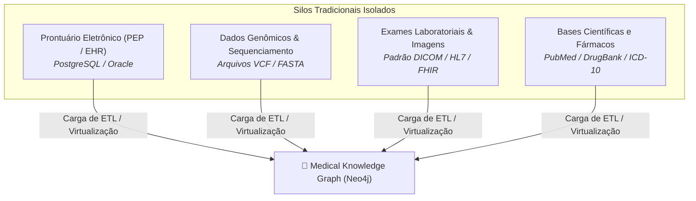
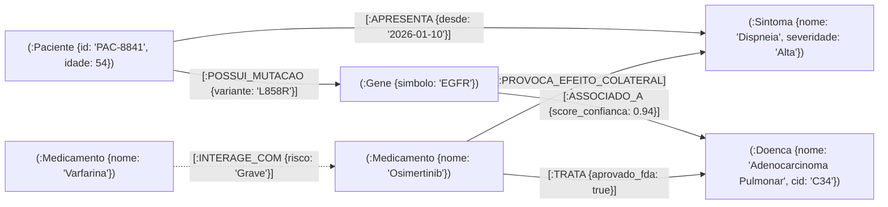
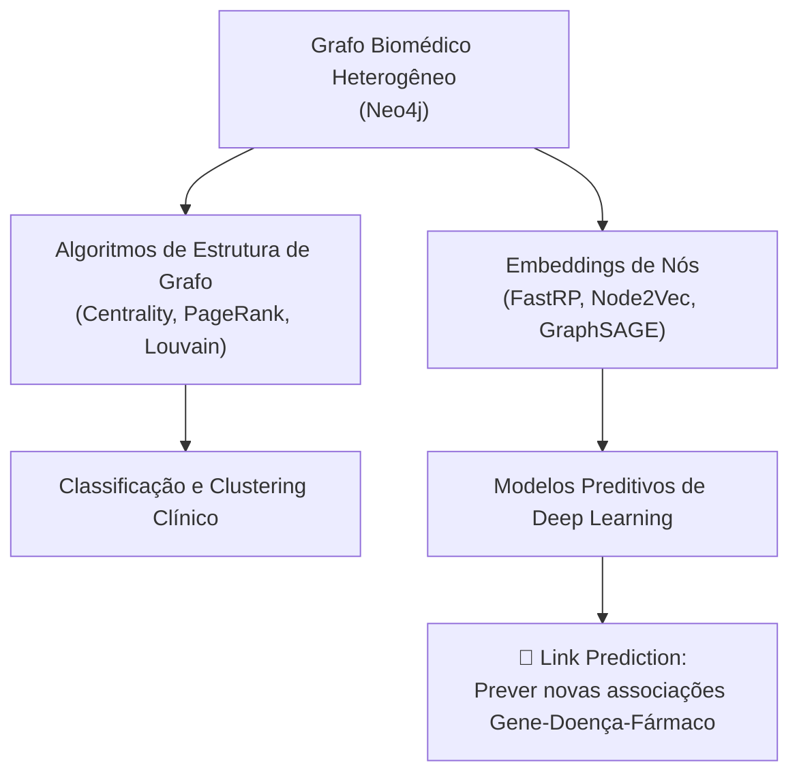

## 👨‍🏫 Metadados e Informações Acadêmicas
- **Instituição:** Faculdade de Tecnologia de Ferraz de Vasconcelos (FATEC-FV)
- **Curso:** Análise e Desenvolvimento de Sistemas (ADS)
- **Disciplina:** Tópicos em Banco de Dados e Big Data
- **Professor Orientador:** Prof. Francisco Abreu
- **Pesquisador / Desenvolvedor:** Josias Sobrinho
- **Documento:** Estudo de Caso Avançado — Medical Knowledge Graphs com Neo4j

# 🧬 Grafos de Conhecimento em Saúde: O Papel do Neo4j em Pesquisas Médicas e Medicina de Precisão

> [!NOTE]
> Este artigo técnico explora como o banco de dados orientado a grafos **Neo4j** é empregado por centros de pesquisa, hospitais de alta complexidade e empresas farmacêuticas para cruzar dados clínicos, genômicos e farmacológicos.
> - Para configurar o ambiente local com Docker e praticar os comandos Cypher deste artigo, consulte o [README.md - Atividade Prática](/README.md).
> - Para a fundamentação teórica sobre nós, arestas e arquitetura de grafos, consulte o [neo4j.md - Guia Teórico](/neo4j.md).

---

## 🎯 1. O Desafio dos Silos de Dados Biomédicos

Na pesquisa médica moderna e na prática clínica hospitalar, o maior obstáculo para a descoberta de curas e diagnósticos precoces não é a escassez de dados, mas sim a sua **extrema fragmentação em silos estanques**:



### Por que bancos relacionais tradicionais falham nesse cenário?
- **Explosão Combinatória de JOINs:** Cruzar o genoma de um paciente com seu prontuário, sintomas relatados, medicamentos em uso e artigos científicos publicados exige conectar 8 a 12 tabelas diferentes. Em SQL, essa consulta gera operações de `JOIN` proibitivamente lentas que travam os servidores.
- **Heterogeneidade dos Dados:** Dados médicos misturam códigos estruturados (CID-10, SNOMED-CT), medições numéricas, séries temporais e textos livres não estruturados.
- **Evolução Contínua da Ciência:** Uma nova rota biológica descoberta em laboratório invalida modelos relacionais rígidos e exige reestruturações caras de DDL.

O Neo4j soluciona esse gargalo ao atuar como um **Medical Knowledge Graph (Grafo de Conhecimento Médico)**, unificando entidades heterogêneas em uma malha relacional navegável em tempo real.

---

## 🧬 2. Modelagem do Grafo Biomédico (Property Graph Model)

No Neo4j, todas as entidades clínicas e biológicas tornam-se **Nós** com propriedades, enquanto seus relacionamentos expressam causalidade, tratamento, sintomatologia ou associação genética:



### Principais Rótulos de Nós (*Labels*):
- `(:Paciente)`: Identificador pseudonimizado, gênero, idade, comorbidades.
- `(:Gene)`: Símbolo oficial (HUGO), localização cromossômica, função celular.
- `(:Variante)`: Mutações pontuais (SNPs), deleções ou inserções no DNA.
- `(:Doenca)`: Nomenclatura médica, classificação CID-10/ICD-11, estadiamento oncológico.
- `(:Medicamento)`: Princípio ativo, classe terapêutica, mecanismo farmacológico.
- `(:Sintoma)`: Vocabulário padronizado (SNOMED-CT / MedDRA), intensidade.
- `(:EnsaioClinico)`: Protocolos de pesquisa em andamento (ClinicalTrials.gov), fase (I, II, III).

### Principais Tipos de Relacionamentos:
- `-[:APRESENTA {data, severidade}]->`
- `-[:POSSUI_MUTACAO {tecido: "Biópsia"}]->`
- `-[:ASSOCIADO_A {evidencia: "PubMed-32145"}]->`
- `-[:TRATA {linha_tratamento: 1}]->`
- `-[:INTERAGE_COM {tipo: "Farmacocinética"}]->`
- `-[:PROVOCA_EFEITO_COLATERAL {frequencia: "Comum"}]->`

---

## 🔬 3. Quatro Aplicações Práticas em Pesquisa Clínica

### 3.1. Medicina de Precisão e Oncologia Personalizada
Tradicionalmente, pacientes com o mesmo tipo de câncer recebiam protocolos padronizados de quimioterapia. Na medicina de precisão com Neo4j:
- O perfil de sequenciamento genético do paciente é mapeado no grafo.
- O sistema cruza as mutações específicas do indivíduo com terapias-alvo aprovadas que demonstraram eficácia estatística em outros pacientes com o mesmo perfil molecular.

> **Exemplo Clínico:** O grafo identifica que um paciente diagnosticado com adenocarcinoma pulmonar possui a mutação `L858R` no gene `EGFR`. Em vez de quimioterapia genérica, o grafo aponta diretamente o inibidor de tirosina quinase de terceira geração (*Osimertinib*).

---

### 3.2. Redirecionamento de Medicamentos (*Drug Repurposing*)
Desenvolver um novo fármaco sintético do zero leva em média **12 a 15 anos** e custa mais de **US$ 2 bilhões**, com altíssima taxa de reprovação em fases clínicas.
- Com o Neo4j, cientistas buscam **vias biológicas compartilhadas**:
  - Se a *Doença X* (sem tratamento eficaz) é causada pela superexpressão de uma proteína regulada pelo *Gene G*;
  - E o *Medicamento Y* (já aprovado comercialmente para artrite) inibe comprovadamente a ação do *Gene G*;
  - O grafo revela imediatamente o medicamento candidato para novos ensaios clínicos, economizando anos de pesquisa pré-clínica de segurança.

---

### 3.3. Farmacovigilância e Detecção de Polifarmácia Adversa
Pacientes idosos ou crônicos frequentemente consomem 5 a 10 medicamentos diários prescritos por médicos de especialidades distintas (*Polifarmácia*).
- Ensaios clínicos de novos medicamentos testam as substâncias isoladamente ou em duplas; eles raramente conseguem prever combinações quádruplas ou quíntuplas.
- O Neo4j analisa a rede de milhões de prescrições hospitalares para detectar padrões ocultos:
  $$\text{Medicamento A} + \text{Medicamento B} \longrightarrow \text{Efeito Adverso Inédito C}$$

---

### 3.4. Trajetória Temporal da Doença e Diagnóstico Precoce
Doenças neurodegenerativas (como Alzheimer) e condições autoimunes (como Lúpus) desenvolvem-se de forma silenciosa ao longo de décadas.
- O grafo organiza prontuários em **trilhas temporais** (*Time-Series Graph*).
- Algoritmos identificam quais combinações de exames alterados e sintomas subclínicos surgem consistentemente de 2 a 5 anos antes da eclosão da fase aguda da doença, permitindo intervenções profiláticas preventivas.

---

## 💻 4. Laboratório Prático: Mini-Grafo Biomédico em Cypher

Você pode colar e executar os blocos a seguir diretamente no **Neo4j Browser** ([http://localhost:7474](http://localhost:7474)) configurado na atividade prática:

### 4.1. Criar o Grafo Biomédico de Demonstração

```cypher
// 1. Criando Pacientes
MERGE (p1:Paciente {id: "PAC-01", nome: "Helena Ramos", idade: 48, cidade: "São Paulo"})
MERGE (p2:Paciente {id: "PAC-02", nome: "Marcos Lima", idade: 62, cidade: "Ferraz de Vasconcelos"})

// 2. Criando Doenças e Sintomas
MERGE (d_cancer:Doenca {nome: "Carcinoma Pulmonar", cid: "C34.9"})
MERGE (d_hipertensao:Doenca {nome: "Hipertensão Essencial", cid: "I10"})

MERGE (s_tosse:Sintoma {nome: "Tosse Seca Persistente"})
MERGE (s_fadiga:Sintoma {nome: "Fadiga Crônica"})
MERGE (s_arritmia:Sintoma {nome: "Arritmia Cardíaca"})

// 3. Criando Genes e Mutações
MERGE (g_egfr:Gene {simbolo: "EGFR", nome: "Epidermal Growth Factor Receptor"})
MERGE (g_kras:Gene {simbolo: "KRAS", nome: "KRAS Proto-Oncogene"})

// 4. Criando Medicamentos
MERGE (m_osimertinib:Medicamento {nome: "Osimertinib", classe: "Inibidor de Tirosina Quinase"})
MERGE (m_cisplatina:Medicamento {nome: "Cisplatina", classe: "Agente Alquilante"})
MERGE (m_antiarritmico:Medicamento {nome: "Amiodarona", classe: "Antiarrítmico"})

// 5. Conectando a Biologia do Câncer
MERGE (g_egfr)-[:ASSOCIADO_A {evidencia: "Nível 1A", score: 0.98}]->(d_cancer)
MERGE (m_osimertinib)-[:TRATA {tipo: "Terapia-Alvo", eficacia: "80%"}]->(d_cancer)
MERGE (m_cisplatina)-[:TRATA {tipo: "Quimioterapia Padrão", eficacia: "45%"}]->(d_cancer)

// 6. Conectando Efeitos Colaterais e Interações Perigosas
MERGE (m_osimertinib)-[:PROVOCA_EFEITO_COLATERAL {frequencia: "Comum"}]->(s_fadiga)
MERGE (m_osimertinib)-[:INTERAGE_COM {gravidade: "Alta", risco: "Prolongamento de Intervalo QT"}]->(m_antiarritmico)
MERGE (m_antiarritmico)-[:PROVOCA_EFEITO_COLATERAL]->(s_arritmia)

// 7. Conectando Prontuários dos Pacientes
MERGE (p1)-[:POSSUI_MUTACAO {variante: "T790M", biopsia_data: "2026-02-15"}]->(g_egfr)
MERGE (p1)-[:DIAGNOSTICADO_COM {data: "2026-02-20"}]->(d_cancer)
MERGE (p1)-[:APRESENTA {desde: "2026-01-05"}]->(s_tosse)
MERGE (p1)-[:TOMA_MEDICAMENTO]->(m_antiarritmico)

MERGE (p2)-[:POSSUI_MUTACAO {variante: "G12C"}]->(g_kras)
MERGE (p2)-[:DIAGNOSTICADO_COM {data: "2026-01-11"}]->(d_hipertensao);
```

---

### 4.2. Consultas Clínicas e de Pesquisa

#### Consulta 1: Terapia-Alvo Personalizada
*Encontrar a terapia direcionada mais eficaz com base na mutação genética específica do paciente Helena Ramos:*

```cypher
MATCH (p:Paciente {nome: "Helena Ramos"})-[:POSSUI_MUTACAO]->(g:Gene)
MATCH (g)-[:ASSOCIADO_A]->(d:Doenca)
MATCH (m:Medicamento)-[t:TRATA]->(d)
WHERE t.tipo = "Terapia-Alvo"
RETURN p.nome AS Paciente, 
       g.simbolo AS GeneMutado, 
       d.nome AS Diagnostico, 
       m.nome AS MedicamentoAlvo, 
       t.eficacia AS TaxaResposta;
```

---

#### Consulta 2: Alerta Clínico de Interação Medicamentosa Crítica (Polifarmácia)
*Verificar se o medicamento-alvo recomendado entra em conflito grave com o que a paciente já consome no dia a dia:*

```cypher
MATCH (p:Paciente {nome: "Helena Ramos"})-[:TOMA_MEDICAMENTO]->(m_atual:Medicamento)
MATCH (m_alvo:Medicamento {nome: "Osimertinib"})
MATCH (m_alvo)-[i:INTERAGE_COM]-(m_atual)
RETURN p.nome AS Paciente,
       m_alvo.nome AS MedicamentoProposto,
       m_atual.nome AS MedicamentoEmUso,
       i.gravidade AS GravidadeAlerta,
       i.risco AS RiscoClinico;
```

> [!CAUTION]
> **Resultado da Investigação Clínica no Grafo:**
> O grafo detecta instantaneamente que prescrever *Osimertinib* junto com *Amiodarona* coloca a paciente em risco imediato de *Prolongamento de Intervalo QT* e morte súbita por arritmia. Esse tipo de alerta cruzado salva vidas ao unificar especialidades médicas diferentes.

---

#### Consulta 3: Hipótese de Redirecionamento de Drogas (*Drug Repurposing*)
*Buscar fármacos aprovados para outras doenças que modulam genes associados à doença investigada:*

```cypher
MATCH (d_alvo:Doenca {nome: "Carcinoma Pulmonar"})<-[:ASSOCIADO_A]-(g:Gene)
MATCH (g)<-[:ATUA_SOBRE]-(m:Medicamento)-[:TRATA]->(outra_doenca:Doenca)
WHERE outra_doenca <> d_alvo
RETURN m.nome AS DrogaCandidata, 
       outra_doenca.nome AS IndicacaoAtual, 
       g.simbolo AS AlvoBiologicoCompartilhado;
```

---

## 🤖 5. O Papel da Inteligência Artificial: Neo4j Graph Data Science (GDS)

As fronteiras da bioinformática combinam o Neo4j com bibliotecas de aprendizado de máquina em grafos (**Graph Data Science - GDS**):



1. **Previsão de Arestas (*Link Prediction*):**
   Algoritmos matemáticos calculam a probabilidade de existir uma relação biológica ainda não descoberta fisicamente entre uma molécula química e uma proteína viral, acelerando o desenvolvimento de antivirais e vacinas.
2. **Detecção de Comunidades (*Community Detection - Louvain / Leiden*):**
   Agrupa subgrupos de pacientes não por idade ou gênero, mas pela semelhança topológica de suas redes moleculares, descobrindo novos subtipos clínicos de doenças raras.
3. **GraphRAG na Medicina (Retrieval-Augmented Generation):**
   Modelos de Linguagem (LLMs como Gemini e Claude) utilizam o grafo de conhecimento médico como **fonte da verdade verificável**. Ao receber perguntas clínicas de médicos, o LLM consulta os nós e arestas do Neo4j, fornecendo respostas com precisão biomédica, referências a artigos reais do PubMed e **zero alucinação**.

---

## 🔒 6. Privacidade, Ética e Governança (LGPD e HIPAA)

A aplicação de grafos a dados sensíveis de pacientes exige conformidade com legislações de proteção de dados (LGPD no Brasil e HIPAA nos EUA):

- **Pseudonimização Estrutural:** O nó do paciente nunca armazena CPF, RG ou nome civil em texto claro na base de pesquisa; utiliza-se um identificador sintético (*hash/UUID* criptográfico).
- **Controle de Acesso Baseado em Grafos (Graph-Based Access Control):** Diferentes perfis de usuários possuem filtros dinâmicos na linguagem Cypher — pesquisadores têm acesso a dados moleculares e agregados, enquanto médicos assistentes acessam prontuários clínicos autorizados.
- **Rastreabilidade de Proveniência (*Data Provenance*):** Cada aresta do grafo registra metadados de origem: data de inserção, laboratório de sequenciamento e versão da literatura científica.

---

## 📚 7. Conclusão

O uso do Neo4j na área biomédica representa uma mudança de paradigma: da medicina reativa baseada em sintomas gerais para a **medicina preditiva, preventiva e personalizada baseada em redes moleculares**. Ao transformar terabytes de prontuários e genomas em grafos conectados, pesquisadores conseguem navegar pelo organismo humano com a mesma facilidade com que navegamos em mapas digitais.

---

## 🔗 Leituras Complementares
- Pratique as consultas executando o ambiente local: [README.md - Roteiro com Docker](/README.md)
- Aprofunde-se nos fundamentos matemáticos e estruturais: [neo4j.md - Guia Teórico](/neo4j.md)
