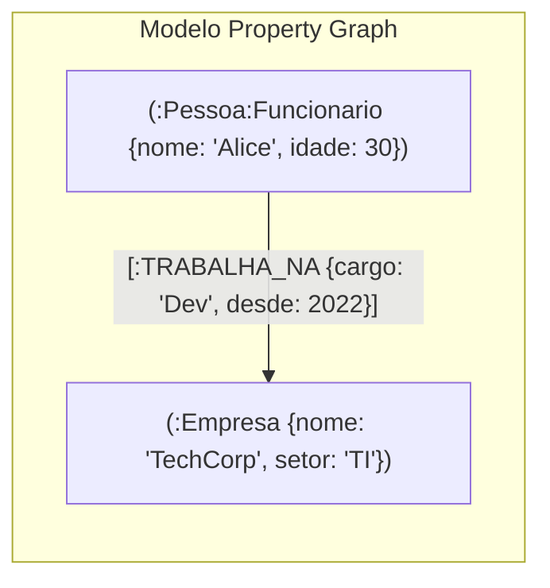
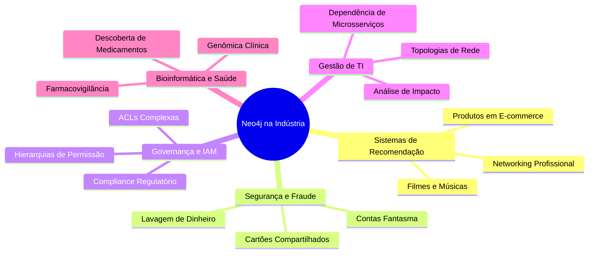

## 👨‍🏫 Metadados e Informações Acadêmicas
- **Instituição:** Faculdade de Tecnologia de Ferraz de Vasconcelos (FATEC-FV)
- **Curso:** Análise e Desenvolvimento de Sistemas (ADS)
- **Disciplina:** Tópicos em Banco de Dados e Big Data
- **Professor Orientador:** Prof. Francisco Abreu
- **Pesquisador / Desenvolvedor:** Josias Sobrinho
- **Documento:** Guia Teórico e Conceitual de Bancos de Dados Orientados a Grafos

# 📘 Guia Teórico: Fundamentos do Neo4j e Bancos Orientados a Grafos

> [!NOTE]
> Este documento fornece a fundamentação conceitual, arquitetural e comparativa do **Neo4j**. Para o roteiro prático com Docker e comandos executáveis, consulte o [README.md](/README.md). Para o estudo de caso aplicado à área da saúde e genômica, consulte [neo4j-pesquisas-medicas.md](/neo4j-pesquisas-medicas.md).

---

## 🌐 1. O que é o Neo4j?

O **Neo4j** é o sistema de gerenciamento de banco de dados NoSQL **orientado a grafos** mais adotado no mundo corporativo e acadêmico. Implementado em Java e Scala, foi projetado do zero para tratar **relacionamentos entre dados como cidadãos de primeira classe**.

Enquanto os bancos relacionais tradicionais (como PostgreSQL, MySQL e Oracle) armazenam informações em tabelas isoladas e resolvem relações em tempo de consulta por meio de operações custosas de junção (`JOIN`), o Neo4j armazena as conexões diretamente em sua estrutura física de armazenamento.

---

## 🧱 2. Estrutura Central: O Modelo Property Graph (Grafo de Propriedades)

O modelo de dados adotado pelo Neo4j é denominado **Labeled Property Graph** (Grafo de Propriedades Rotulado). Ele é composto por quatro elementos fundamentais:



### 2.1. Nós (Nodes)
- Representam as **entidades** do domínio de negócio (ex.: uma pessoa, um cliente, um equipamento, um gene).
- São equivalentes a uma linha ou registro de uma tabela relacional.
- Podem conter zero, uma ou múltiplas propriedades chave-valor.

### 2.2. Rótulos (Labels)
- Atuam como **marcadores semânticos de categoria** ou tipo para os nós (ex.: `:Pessoa`, `:Cliente`, `:Professor`).
- Um mesmo nó pode possuir múltiplos rótulos simultaneamente (ex.: `(u:Pessoa:Usuario:Administrador)`), permitindo indexações seletivas e herança conceitual flexível sem rigidez estrutural.

### 2.3. Relacionamentos (Relationships)
- Conectam **dois nós** de forma explícita e significativa.
- Possuem regras estruturais obrigatórias no Neo4j:
  1. **Tipo obrigatório:** Devem possuir um identificador semântico claro (ex.: `[:AMIGO_DE]`, `[:COMPROU]`, `[:MINISTRA]`).
  2. **Direção obrigatória:** Toda aresta é criada com um nó de origem (*start node*) e um nó de destino (*end node*). Contudo, em consultas Cypher, podem ser navegadas de forma bidirecional ou sem restrição de direção quando o sentido for simétrico.
  3. **Não existem arestas órfãs:** Um relacionamento não pode existir sem os dois nós que ele conecta.
  4. **Propriedades em arestas:** Diferente dos modelos de grafos simples, no Neo4j os relacionamentos podem conter atributos próprios (ex.: o relacionamento `[:TRABALHA_NA]` pode guardar `desde: 2021`, `salario: 8500`, `cargo: "Engenheiro"`).

### 2.4. Propriedades (Properties)
- Pares no formato **chave: valor** armazenados internamente em nós e relacionamentos.
- Suportam tipos de dados primitivos: strings, inteiros, números decimais, booleanos, datas/horas e arrays de tipos homogêneos.

---

## ⚡ 3. Arquitetura Interna: Por que o Neo4j é tão rápido?

A velocidade excepcional do Neo4j em consultas relacionais complexas decorre de sua arquitetura de baixo nível:

```mermaid
flowchart TD
    subgraph "RDBMS Tradicional (Custo de JOIN)"
        T1["Tabela A"] -->|Varredura de Índice B-Tree| PK1["Índice FK"]
        PK1 -->|Lookup O(log N)| T2["Tabela B"]
        T2 -->|Novo JOIN O(log M)| T3["Tabela C"]
    end

    subgraph "Neo4j (Index-Free Adjacency)"
        NodeA["Nó A"] -->|Ponteiro Direto O(1)| NodeB["Nó B"]
        NodeB -->|Ponteiro Direto O(1)| NodeC["Nó C"]
    end
```

### 3.1. Adjacência Livre de Índices (*Index-Free Adjacency*)
- Nos bancos relacionais, para juntar três tabelas (`Cliente` $\rightarrow$ `Pedido` $\rightarrow$ `Produto`), o motor de consulta consulta índices globais B-Tree para cada relacionamento. À medida que a base cresce de milhares para milhões de linhas, o custo computacional cresce na ordem de $O(\log N)$ para cada junção.
- No Neo4j, **cada nó mantém ponteiros diretos em disco e memória** para seus nós adjacentes. A travessia de um nó para seus vizinhos ocorre em **tempo constante $O(1)$**, independentemente do tamanho total da base de dados (seja ela de 10 mil nós ou 10 bilhões de nós).

### 3.2. Estrutura de Arquivos Especializada (*Native Graph Storage*)
- O Neo4j não armazena dados em blocos genéricos de tabelas. Ele utiliza estruturas de registro de tamanho fixo em disco:
  - `neostore.nodestore.db`: armazena os nós.
  - `neostore.relationshipstore.db`: armazena os relacionamentos como listas duplamente encadeadas.
  - `neostore.propertystore.db`: armazena propriedades primitivas e ponteiros para blocos de strings ou arrays dinâmicos.
- O formato de tamanho fixo permite que o banco calcule o endereço exato do registro em bytes com aritmética de ponteiros imediata: $\text{Offset} = \text{ID} \times \text{Tamanho\_Registro}$.

---

## 📊 4. Matriz Comparativa: Relacional vs. Documento vs. Colunar vs. Grafos

| Paradigma | Banco Representativo | Modelo de Dados | Ponto Forte | Desafio / Gargalo |
| :--- | :--- | :--- | :--- | :--- |
| **Relacional** | PostgreSQL, MySQL | Tabelas, Linhas, Colunas, FKs | Transações ACID estritas, esquemas rígidos, dados estruturados tabulares | JOINs profundos em grafos/redes complexas |
| **Documentos** | MongoDB, CouchDB | Documentos JSON / BSON hierárquicos | Esquema flexível, leitura rápida de agregados autocontidos | Relacionamentos entre documentos distintos |
| **Colunar / Wide-Column** | Apache Cassandra | Famílias de colunas, partição distribuída | Escrita em altíssima escala distribuída globalmente | Consultas ad-hoc fora da Partition Key |
| **Orientado a Grafos** | **Neo4j** | **Nós, Rótulos, Relacionamentos e Propriedades** | **Travessias profundas de múltiplos saltos, busca de caminhos, redes complexas** | Agregações globais massivas de varredura completa (*Full Scans*) |

---

## 🛠️ 5. Principais Casos de Uso na Indústria

O Neo4j é a ferramenta de escolha em cenários onde a pergunta central envolve **"como as entidades estão conectadas?"**:



1. **Sistemas de Recomendação em Tempo Real:**
   - Sugestão contextual ("Quem comprou X também comprou Y", "Conexões de 2º e 3º grau no LinkedIn").
   - Respostas em milissegundos enquanto o usuário navega na aplicação.

2. **Detecção de Fraudes Financeiras e Análise de Vínculos:**
   - Identificação de anéis de fraude (*fraud rings*), onde estelionatários compartilham números de telefone, endereços IP ou contas bancárias em triangulações disfarçadas.

3. **Gerenciamento de Identidade, Acesso e Autorização (IAM / RBAC):**
   - Mapeamento dinâmico de hierarquias de papéis, herança de grupos e controle de privilégios em organizações com dezenas de milhares de usuários.

4. **Análise de Impacto e Dependências de TI:**
   - Visualização da infraestrutura corporativa: servidores, contêineres, microsserviços, filas e bancos de dados, permitindo simular instantaneamente o impacto da queda de um roteador ou servidor.

5. **Bioinformática, Saúde e Pesquisa Médica:**
   - Unificação de silos de prontuários, interações medicamentosas, vias metabólicas e mutações genéticas em *Medical Knowledge Graphs* (ver [estudo aprofundado](/neo4j-pesquisas-medicas.md)).

---

## 🔍 6. A Linguagem Cypher em Resumo

A linguagem **Cypher** é para os bancos de grafos o equivalente ao que o SQL é para os relacionais. Ela foi projetada com a premissa de ser **humana, declarativa e baseada em arte ASCII**:

```cypher
MATCH (usuario:Pessoa {nome: "Carlos"})-[:AMIGO_DE]->(amigo:Pessoa)
WHERE amigo.idade >= 18
RETURN amigo.nome AS Amigo, amigo.idade AS Idade
ORDER BY amigo.nome ASC;
```

### Anatomia dos Símbolos:
- `()` Parênteses representam um **Nó** (lembra um círculo de um grafo desenhado em um quadro branco).
- `[]` Colchetes representam as propriedades e metadados de um **Relacionamento**.
- `-->` Setas e traços representam a **Linha e Direção** do relacionamento.

---

## ⚖️ 7. Quando Usar e Quando Evitar o Neo4j

### ✅ Cenários Ideais para o Neo4j
- Seus dados possuem conexões ricas, interligadas e com múltiplos graus de profundidade.
- As consultas exigem encontrar caminhos (*shortestPath*), rotas ou padrões topológicos.
- O modelo de domínio evolui constantemente e precisa acomodar novos tipos de conexões sem paradas de migração de esquema.
- Seu sistema precisa de transações **ACID** estritas em estruturas de rede.

### ❌ Cenários Onde o Neo4j NÃO é a Melhor Escolha
- **Data Warehousing e BI Analítico Puro:** Cálculos que exigem varrer todas as colunas de bilhões de linhas para calcular somas e médias globais (bancos colunares como ClickHouse, BigQuery ou Snowflake são muito mais eficientes).
- **Armazenamento de Objetos Binários Grandes:** Guardar imagens, vídeos ou documentos pesados (utilize Object Storage como Amazon S3, MinIO ou GCP Cloud Storage).
- **Dados Isolados com Pouca ou Nenhuma Conexão:** Tabelas cadastrais estáticas que quase não se relacionam funcionam com menor custo e maior simplicidade em bancos relacionais tradicionais.

---

## 🔗 Referências e Próximos Passos
- Para praticar todos esses conceitos em um ambiente local com contêineres Docker, execute o [README.md - Atividade Prática com Neo4j](/README.md).
- Para compreender a aplicação prática do Neo4j na área de oncologia, farmacovigilância e bioinformática, leia [neo4j-pesquisas-medicas.md](/neo4j-pesquisas-medicas.md).
